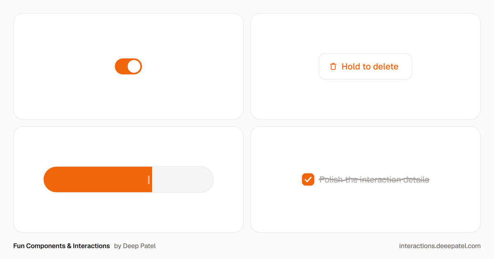

# Fun Components & Interactions



A UI playground by Deep Patel for exploring how small details make interfaces feel better: a switch settling into place, a slider responding to a drag, or a heart celebrating a click. The project includes a live showcase and reusable React components with their styles and animation code.

**[Explore the live demo](https://interactions.deeepatel.com/)** · **[About the creator](https://deeepatel.com)**

## Who is this for?

- **Designers:** try the interactions and use them as references when discussing motion, feedback, and visual details.
- **Engineers:** explore how the interactions are built, adjust them locally, and adapt the components for your own UI.
- **Design engineers:** experiment with appearance and behavior together, then compare the results in the demo pages.

This repository is a Next.js application with a component collection inside it. It is private in `package.json` and has no package publishing setup; the examples below use components directly within this project.

## What you can explore

The homepage shows five interactions, with cursor-following googly eyes above them. On desktop, scroll sideways through the tiles using your mouse wheel or trackpad. On smaller screens, the tiles stack vertically.

| Component | What it does | Where to try it locally |
| --- | --- | --- |
| Switch | Toggles on and off with animated feedback. | `/`, `/test`, `/test/grid` |
| Hold to Delete | Confirms after a press and hold; releasing early cancels. | `/`, `/test`, `/test/grid` |
| Slider | Adjusts a value by dragging, with spring motion. | `/`, `/test`, `/test/grid` |
| Heart | Toggles a like with a bounce and confetti. | `/`, `/test/grid` |
| Checkbox | Checks and unchecks items in a list. | `/`, `/test`, `/test/grid` |
| Googly Eyes | Follows the cursor, blinks automatically, and reacts to clicks. | `/` |
| Button | Supports variants, sizes, loading, icons, and optional confetti. | `/test` |
| Counter | Increases or decreases a number with animated digits. | `/test` |
| Input | A text field with labels, hints, errors, and optional icons. | `/test` |
| Toast | Shows dismissible notifications. | `/test` |
| Menu | Opens a menu of links or buttons. | Exported in the code; no demo page yet. |

Hold to Delete is a visual demo by default. To connect it to an action, pass an `onConfirm` callback.

## Run locally

Install Node.js 20 or newer and npm, then open a terminal in the project folder:

```bash
npm ci
npm run dev
```

Open [localhost:3000](http://localhost:3000). If that port is in use, use the address printed in the terminal. Edits update the page while the development server is running.

No environment variables or backend setup are required. An internet connection is needed to install dependencies and fetch the Google fonts used by `next/font` during development or a build.

### Local demo pages

- **[Homepage](http://localhost:3000):** the main interaction showcase.
- **[Component stage](http://localhost:3000/test):** choose one of eight components from a sidebar to try it in isolation.
- **[Comparison grid](http://localhost:3000/test/grid):** try five interactions side by side.

The `/test` pages are manual demo pages. There is currently no automated test suite configured.

## Use a component

Import components and their TypeScript types from `@/components`. Here is a complete example you can place in a page or component inside this project:

```tsx
'use client';

import { useState } from 'react';
import { MotionConfig } from 'framer-motion';
import { Switch } from '@/components';

export default function ToggleDemo() {
  const [enabled, setEnabled] = useState(false);

  return (
    <MotionConfig reducedMotion="user">
      <Switch
        checked={enabled}
        onChange={setEnabled}
        aria-label="Enable notifications"
      />
    </MotionConfig>
  );
}
```

`checked` supplies the current state; `onChange` updates it. Checkbox and Slider follow the same pattern of receiving a value and an update callback. The props at the top of each component file describe its available options.

For notifications, wrap the consuming components in `ToastProvider`, then call `useToast()` inside them. The existing demo pages already include the provider.

To adapt a component for another React project, bring its `.tsx` file, matching `.module.css` file, and any imported helpers or supporting components. Include the shared styles and tokens, install `framer-motion`, and update the `@/` imports to match your project.

## Find your way around

Built with **Next.js 15 (App Router), React 18, TypeScript, Framer Motion, and CSS Modules**. CSS Modules keep component styles scoped to their component; shared CSS variables keep the visual language consistent.

| Location | What to look for |
| --- | --- |
| `src/app/_components/Showcase.tsx` and `src/app/page.module.css` | Homepage content, demo state, tile layout, and scrolling behavior. `src/app/page.tsx` wraps it with structured data. |
| `src/app/test/` | The component stage and comparison grid. |
| `src/app/layout.tsx` | Global styles, fonts, site-wide metadata, and Microsoft Clarity analytics. |
| `src/lib/site.ts` | Site identity: name, URL, description, interaction list, and FAQ. SEO files read from here. |
| `src/components/` | Component behavior in `.tsx` files and appearance in `.module.css` files. |
| `src/components/index.ts` | The shared list of component and type exports. |
| `src/styles/tokens.css` | Shared colors, spacing, typography, corner radii, shadows, and CSS motion values. |
| `src/styles/globals.css` | Base styles, focus outlines, and CSS reduced-motion handling. |
| `src/styles/icons.tsx` | Shared SVG icons. |
| `src/lib/motion.ts` | Shared spring and transition presets; individual components also define their own motion values. |
| `src/lib/hover.ts` | Rules for enabling hover effects on desktop pointers. |
| `public/` | Static assets: the social sharing image and PWA icons. |
| `scripts/brand-assets.mjs` | Regenerates icons and social images. |

## Change the design or add an interaction

1. **Choose a component** and try it in a demo page to understand its current behavior.
2. **Adjust shared styles** in `tokens.css` for changes across the collection, or edit the component's `.module.css` for a local change. The `--c-*` tokens give components larger spacing, type, and corners than the base page tokens.
3. **Adjust behavior and motion** in the component's `.tsx` file. Use the shared presets in `src/lib/motion.ts` where they fit.
4. **Add new components** to `src/components/index.ts` and wire up a demo in the appropriate page. The demo pages list components explicitly, so exporting a component does not add it to a demo automatically.
5. **Review the result** with a mouse, touch input, and keyboard, at desktop and mobile widths. Check labels, focus states, and the system's Reduce Motion setting.

The homepage uses `MotionConfig reducedMotion="user"`, and global CSS shortens CSS animations when reduced motion is requested. Heart and Hold to Delete also include component-specific handling. Check each interaction when extending it; reduced-motion handling differs across the collection and demo pages.

Dark-theme tokens are available by setting `data-theme="dark"` on the `<html>` element. There is currently no theme switch in the UI.

## SEO and brand files

The site's name, URL, description, interaction list and FAQ live in `src/lib/site.ts`. Every file below reads from it, so update copy there.

| File | Purpose |
| --- | --- |
| `src/app/layout.tsx` | Base URL, title template, description, canonical URL, Open Graph and Twitter tags, robots directives, theme colour. |
| `src/app/page.tsx` | JSON-LD structured data (WebSite, Person, WebApplication, FAQPage) in the homepage HTML. |
| `src/app/_components/Tile.tsx` | Each demo tile's `<h2>` title, so the server-rendered HTML names every interaction. |
| `src/app/robots.ts` → `/robots.txt` | Allows all crawlers, with AI search and training bots named explicitly. |
| `src/app/sitemap.ts` → `/sitemap.xml` | Lists the homepage, the only indexable page. |
| `src/app/manifest.ts` → `/manifest.webmanifest` | Web app manifest with name, colours and PWA icons. |
| `src/app/llms.txt/route.ts` → `/llms.txt` | Plain-text summary for answer engines and LLMs: what it is, how to use it, how it works, FAQ. |
| `src/app/test/layout.tsx` | Marks the `/test` demo pages `noindex`. |
| `src/app/icon.svg`, `favicon.ico`, `apple-icon.png` | Browser tab icon (SVG plus 16/32/48 ICO) and the opaque iOS home-screen icon. |
| `public/icon-192.png`, `icon-512.png`, `icon-maskable-512.png` | Android / PWA install icons. |
| `public/og.png` | 1200×630 social preview, also the README image above. |
| `.github/social-preview.png` | 1280×640 image to upload in GitHub's repository settings. |
| `src/app/og-capture/` | Development-only page the social images are captured from. It returns 404 in production. |

To regenerate the images after changing `icon.svg` or a captured component, start `npm run dev` and run:

```bash
node scripts/brand-assets.mjs --capture
```

Without `--capture` it rebuilds only the icons. The capture uses an installed Edge or Chrome; set `BROWSER_PATH` to use another browser.

## Project commands

| Command | Purpose |
| --- | --- |
| `npm run dev` | Start the local development server. |
| `npm run typecheck` | Check TypeScript types without building the app. |
| `npm run build` | Create a production build. |
| `npm start` | Run the production build locally; run `npm run build` first. |
| `npm run lint` | Run Next.js's lint command. ESLint is not configured or installed in this repository yet, so this may prompt for setup. |

Before sharing a code change, run the type check and production build, then review the affected interactions in the demo pages.
